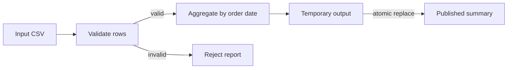

# 01 · Basic batch pipeline

**Goal:** read a CSV order extract, validate records, aggregate accepted order amounts by date, and publish a deterministic summary plus rejected-row report.

## Architecture and flow

Run `python 14-projects/01-basic-batch-pipeline/src/run_pipeline.py` from repository root. Outputs go to `output/` beside the project. Input is synthetic and shipped in `sample_data/orders.csv`.

## Contract and implementation choices

Amounts are parsed as decimal values, dates use ISO `YYYY-MM-DD`, and `order_id` must be present. This educational batch job treats each input file as a complete snapshot; it does not implement CDC, currency conversion, or distributed processing. Output replacement is atomic on a single filesystem. A production object-store sink would need a manifest/commit protocol instead.

## Failure, monitoring, security, cost

Malformed rows are rejected with source line and reason; malformed headers or I/O errors fail the run. For production, emit structured run ID, input identity, accepted/rejected counts, duration, and output version; alert on unexpected reject ratios and freshness. Keep source data access scoped and avoid logging full records. Cost is dominated by storage and compute at scale; this local implementation is not a scale benchmark.

## Tests

`python -m unittest discover -s 14-projects/01-basic-batch-pipeline/tests -v`
