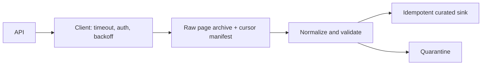

# 02 · API ingestion pipeline

**Goal:** ingest a paginated REST API into immutable raw pages and a normalized table while respecting rate limits and replay boundaries.

## Architecture and data flow

Keep raw responses for audit/reprocessing with access controls and retention. Persist the cursor only after the page is durably archived. Normalize into a versioned schema, then upsert by stable source key and version.

## Trade-offs and operations

Use a stable snapshot token or updated-since cursor where the API supports it; pagination alone may miss updates during concurrent mutation. Honor `Retry-After`, use bounded exponential backoff with jitter for transient failures, and do not retry non-idempotent writes without an idempotency key. Handle 401/403 as terminal configuration/access errors. Monitor pages, records, lag, 429/5xx rates, schema changes, and cursor age.

Tests should use a fake HTTP transport for pagination, retries, duplicate pages, empty pages, malformed payloads, and interrupted resume. Store credentials in a secret manager; redact tokens and payloads. Cost drivers are API quotas, retention, and normalization compute. This brief has no live API dependency.

The dependency-free pagination and retry reference is [`02-python/examples/api_client.py`](../../02-python/examples/api_client.py), tested by [`02-python/tests/test_api_client.py`](../../02-python/tests/test_api_client.py). It deliberately yields pages without persisting a raw archive or advancing a durable cursor; implement that transaction boundary in the project before treating it as restartable ingestion.
