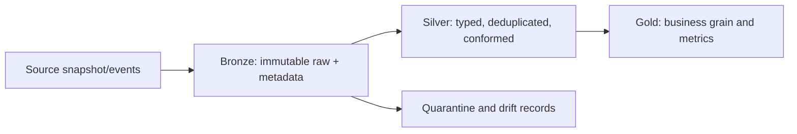

# 03 · Medallion lakehouse

**Goal:** build governed bronze, silver, and gold data products over a transactional lake format.

## Data flow

Bronze preserves source evidence and ingestion metadata. Silver enforces keys, types, deduplication, and quality contracts. Gold exposes documented business grain and metrics. Use Delta transaction semantics where available, but do not infer a guarantee without checking the runtime and write path.

## Trade-offs and controls

Avoid unnecessary copies and unbounded raw retention. Define schema evolution policy, replay window, late-arrival handling, table ownership, catalog grants, lineage, and PII classification. Monitor file counts/sizes, freshness, quality failures, commit conflicts, and query pruning. Optimize based on query and write measurements; compaction, Z-Ordering, and Liquid Clustering have workload and platform-specific trade-offs.

Test each layer with contract fixtures, duplicate/replay cases, schema drift, and access checks. Keep security roles separate across raw and curated data. Cost includes storage versions/retention, compaction, compute, and small-file overhead.
