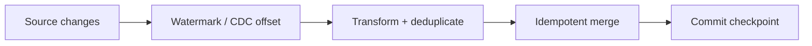

# 04 · Incremental data pipeline

**Goal:** process only changed source data while making checkpoint advancement and output publication recoverable.

## Data flow

Prefer source CDC sequence/LSN when available. A timestamp watermark requires a tie-breaker and overlap window to cover equal timestamps and late commits. Advance checkpoint only after output commit; use a transactional manifest or sink-native transaction if checkpoint and output cannot commit atomically.

## Risks and operations

Define delete semantics, overlap, dedupe key, source retention, and backfill path. Monitor input lag, rows read/written, duplicates, checkpoint age, and reconciliation totals. Test crash between every state transition, repeated batch, out-of-order event, and retention breach. Restrict checkpoint access and encrypt source data. Cost depends on source query strategy, overlap, and merge amplification.
