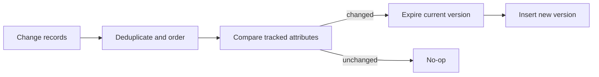

# 05 · SCD Type 2 pipeline

**Goal:** maintain historical dimension versions from ordered change records.

## Data flow

Use a business key plus source sequence to order updates. Store effective start/end and current status; choose inclusive/exclusive boundary semantics and document them. A retry of the same sequence must be a no-op. Late historical changes may require splitting validity intervals rather than simply replacing the current row.

## Trade-offs and quality

Hashing tracked attributes can simplify comparison but requires canonical serialization and null normalization. Test one-current-row, non-overlapping intervals, unchanged values, deletes, duplicates, and out-of-order updates. Monitor change volume and interval anomalies. Restrict sensitive history and define retention/legal deletion. Costs arise from merge rewrites and historical growth.

The tested in-memory update reference is [`04-data-modeling/examples/scd_type2.py`](../../04-data-modeling/examples/scd_type2.py). It rejects out-of-order updates rather than restating historical intervals and does not implement deletes, persistence, concurrency control, or a database transaction.
