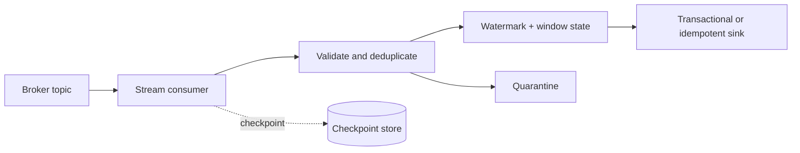

# 06 · Streaming pipeline

**Goal:** consume ordered events, validate them, maintain event-time aggregates, and publish restartable results.

## Data flow

Specify partition key, ordering scope, event ID, event-time field, watermark, output mode, state TTL, and sink commit behavior. A checkpoint is part of query identity and recovery; source retention must cover restart and replay needs.

## Failure and operations

Test duplicate and out-of-order events, late arrivals, malformed records, broker restart, checkpoint loss, and sink outage. Monitor input/output rates, consumer lag, watermark delay, state size, processing latency, and rejected events. Secure topics and checkpoint paths with separate least-privilege roles. Cost drivers include retained events, state storage, partition count, and always-on compute.
