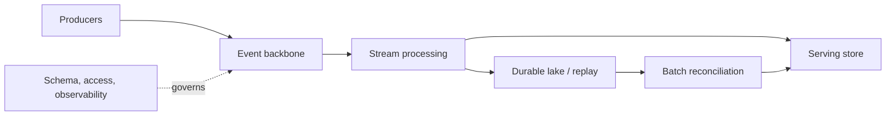

# 07 · Real-time data platform

**Goal:** combine event ingestion, stream processing, serving, and operational controls for low-latency consumers.

## Reference flow

Separate the immutable event history from low-latency serving state. Define freshness and availability targets per consumer; include batch reconciliation as an independent correctness check. Use schema compatibility rules and ownership for topics.

## Trade-offs and controls

Partitioning affects ordering and throughput. Replication, retention, stateful processing, and serving indexes add cost. Design overload behavior, backpressure, poison-event isolation, replay, and disaster recovery. Monitor end-to-end event age, lag by partition, error rates, state size, and serving availability. Restrict PII at ingestion and in replay storage. Test load, failover, replay, and degraded dependencies before claiming an SLO.
