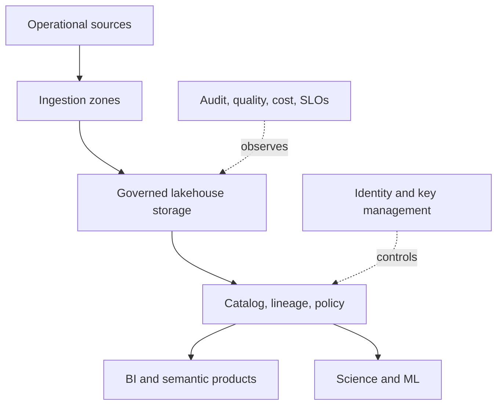

# 08 · Enterprise lakehouse

**Goal:** design a multi-domain lakehouse with governance, workload isolation, lifecycle, and controlled self-service.

## Platform view

Organize ownership by domain and data product, with centrally managed identity, catalog policy, network boundaries, audit, and platform standards. Define raw/curated access separately and classify sensitive data at ingestion.

## Trade-offs and operations

Address tenant/workload isolation, noisy neighbors, open format interoperability, catalog portability, retention/legal deletion, lineage completeness, disaster recovery, and chargeback/showback. Cost controls include workload budgets, autoscaling boundaries, file compaction policy, storage lifecycle, and query scanning metrics. Test access policies, regional recovery, catalog restore, schema evolution, and cross-domain sharing. Avoid claiming a governance control is effective until validated end to end.
