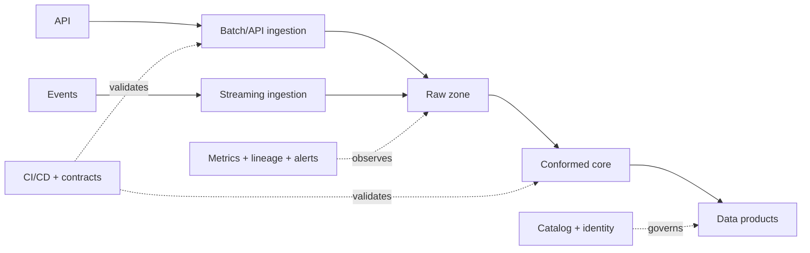

# 09 · End-to-end data platform

**Goal:** integrate source onboarding, batch and streaming ingestion, governed lakehouse tables, orchestration, quality, CI/CD, observability, and consumer products.

## End-to-end flow

Create a source onboarding contract, reusable ingestion interfaces, a medallion data path, a data product with explicit owner/SLO, and promotion automation. Keep cloud services replaceable behind documented boundaries where practical.

## Delivery and operational design

CI validates unit tests, contract compatibility, and deployment plans; CD promotes versioned artifacts through separated environments. Define idempotent replay, schema evolution, backfill isolation, incident response, secrets management, access audit, and spend ownership. Test normal runs and injected failures from source through consumer. Cost model must separate storage, batch compute, streaming baseline, network, and query/BI usage. Start with a small bounded scope; enterprise breadth is a sequence of deliverables, not a single framework.
