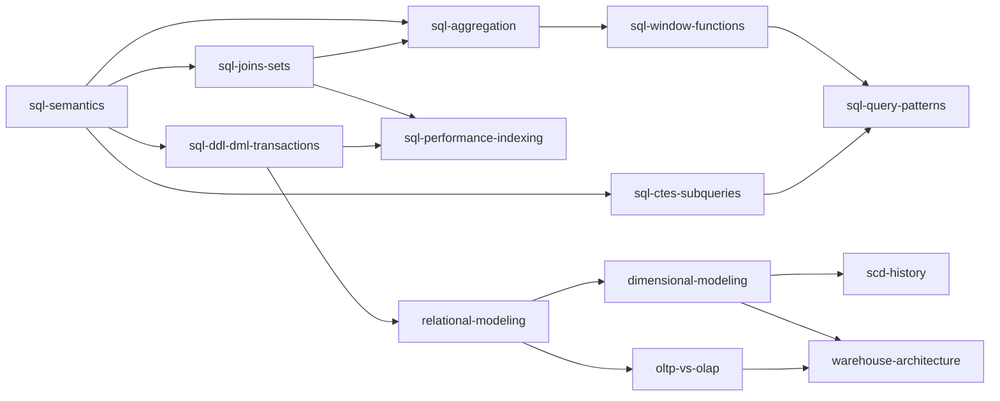
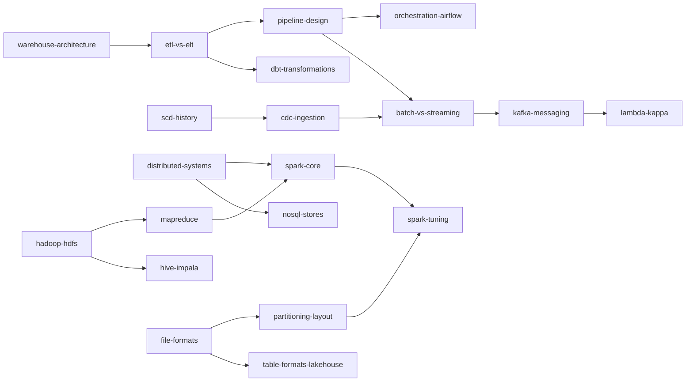
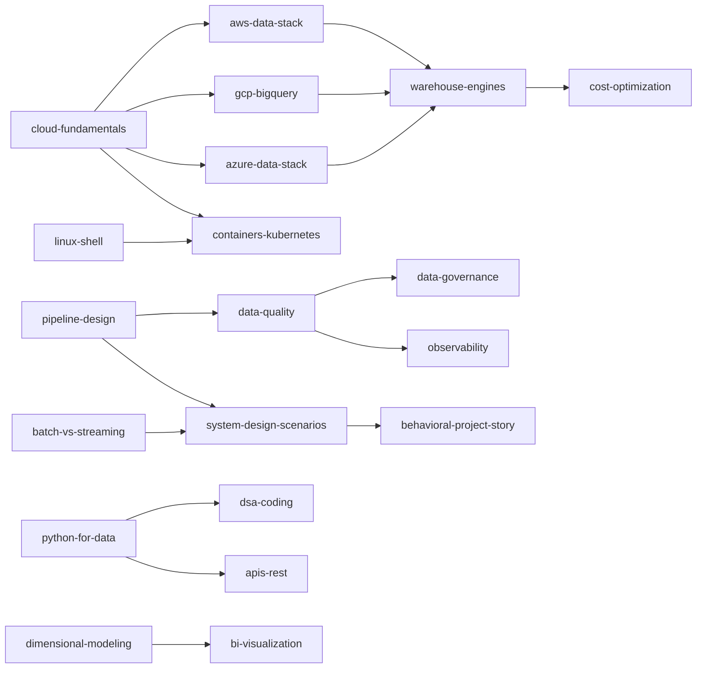

# Data engineering interview knowledgebase

A linked graph of every topic across three question banks, merged by subject and wired together
by prerequisite. Built 4 Sep 2026.

**Sources** (raw copies in `_sources/`, so this works offline and the answers stay traceable).
Provenance and licence status for each: [`SOURCES.md`](SOURCES.md).

| Source | What it is | Volume |
|---|---|---|
| `_sources/obenner/*.md` | OBenner/data-engineering-interview-questions — 38 topic files | ~2,600 questions |
| `_sources/devinterview.md` | Devinterview-io "Top 100 Data Engineer Interview Questions" | **15** questions with long answers — the repo README only publishes 15 of the advertised 100, the rest are on devinterview.io. All 15 are modelling/warehouse/ETL. |
| `_sources/cookbook_interview.md` | andkret/Cookbook §08 Interview Questions | ~134 questions, topic-grouped, mostly unanswered |

`_sources/devinterview_titles.md` recovers the *titles* of that source's questions 1–69 from the
website (answers are paywalled) and maps every one of them to the node here that answers it —
use it as a self-test index. All 69 landed inside the existing taxonomy, so nothing is missing.

## How to use it

Every topic is one file in `nodes/`, and every file ends with a `Graph` section linking to its
prerequisites, its successors, and the topics it gets asked alongside. Three ways to read it:

1. **Obsidian** (best) — open this repo's folder as a vault. The wikilinks
   become a real graph you can see and walk. Graph view, then filter by `tier:`.
2. **Terminal** — `grep -rl 'kafka' nodes/` to find entry points, `grep -A3 '★' nodes/*.md` to
   pull only the high-frequency questions.
3. **Drill mode** — each file's *Must be able to recite* section is a cover-the-answer list.
   Say them out loud. That is the format that fails in interviews, so that is the format to
   practise.

Each file has the same five sections: **Say it in one line** · **Must be able to recite** ·
**Questions actually asked** (★ = appears in more than one source) · **Traps** · **Graph**.

## Start here — the five that get missed most

These five carry the definitions interviewers open with and candidates most often fumble. Do
them before anything else.

| Order | Node | Why first |
|---|---|---|
| 1 | [[sql-ddl-dml-transactions]] | DELETE vs TRUNCATE vs DROP, plus ACID and isolation. The single most commonly asked distinction in the corpus. |
| 2 | [[dimensional-modeling]] | Star **and** snowflake, facts, dimensions, grain. |
| 3 | [[scd-history]] | SCD in full — the name, all types, Type 2 mechanics. |
| 4 | [[cloud-fundamentals]] | Elasticity vs scalability, stated as a contrast rather than an anecdote. |
| 5 | [[system-design-scenarios]] | The scenario round, consolidated into a repeatable framework. |

Two evenings of work, and they cover the openers for almost any round.

## The graph

### Tier 0 — foundations (nothing else stands up without these)

### Tier 1 — pipelines, processing, storage

### Tier 2–4 — cloud, operations, adjacent skills

## Six-week plan

Two hours a day, five days a week. Recite before you read anything new.

| Week | Nodes | Output that proves you did it |
|---|---|---|
| 1 | sql-semantics, sql-joins-sets, sql-aggregation, **sql-ddl-dml-transactions** | All four ★ lists recited cold, no notes |
| 2 | sql-window-functions, sql-ctes-subqueries, sql-query-patterns, sql-performance-indexing | Solve the 10 classic puzzles from scratch, then read one EXPLAIN plan aloud |
| 3 | relational-modeling, **dimensional-modeling**, **scd-history**, warehouse-architecture, oltp-vs-olap | Draw a star schema for a bank transaction feed on paper, declare the grain, add SCD2 to one dimension |
| 4 | etl-vs-elt, pipeline-design, cdc-ingestion, orchestration-airflow, dbt-transformations, data-quality | Describe one pipeline end to end with idempotency, watermark and three tests |
| 5 | **cloud-fundamentals**, aws-data-stack or gcp-bigquery, warehouse-engines, cost-optimization, file-formats, partitioning-layout | Answer "why is this query slow and expensive" for a partitioned Parquet table |
| 6 | batch-vs-streaming, kafka-messaging, spark-core, spark-tuning, **system-design-scenarios**, behavioral-project-story | Talk through three scenarios out loud in ten minutes each |

Tier-4 nodes (python-for-data, dsa-coding, bi-visualization, linux-shell, apis-rest) and the
Hadoop lineage (hadoop-hdfs, mapreduce, hive-impala) are read-once background. Do them in gaps,
not in sequence — but read hadoop-hdfs before any interview at a bank, because their platforms
are older than the job ads suggest.

## Node inventory

| Tier | Nodes |
|---|---|
| 0 foundations | sql-semantics · sql-joins-sets · sql-aggregation · sql-window-functions · sql-ctes-subqueries · sql-ddl-dml-transactions · sql-performance-indexing · sql-query-patterns · relational-modeling · dimensional-modeling · scd-history · warehouse-architecture · oltp-vs-olap |
| 1 pipelines | etl-vs-elt · pipeline-design · orchestration-airflow · dbt-transformations · cdc-ingestion · batch-vs-streaming · kafka-messaging · lambda-kappa |
| 1 processing | spark-core · spark-tuning · hadoop-hdfs · mapreduce · hive-impala |
| 1 storage | file-formats · table-formats-lakehouse · partitioning-layout · distributed-systems · nosql-stores |
| 2 cloud | cloud-fundamentals · aws-data-stack · gcp-bigquery · azure-data-stack · warehouse-engines · containers-kubernetes · cost-optimization |
| 3 operations | data-quality · data-governance · observability · system-design-scenarios · behavioral-project-story |
| 4 adjacent | python-for-data · dsa-coding · bi-visualization · linux-shell · apis-rest |

48 nodes. `_SPEC.md` holds the build contract and the canonical edge table if you want to extend
the graph yourself — add a node, add its row to the edge table, add the wikilinks both ways.

