# Data Engineering Mother Repository

An original, hands-on curriculum for data engineers who build, operate, and design dependable data platforms. It is deliberately not beginner-only: the material emphasizes production trade-offs, failure semantics, governance, cost, and senior-level system design.

The curriculum is informed by the 20 repositories named in the supplied PDF. Their upstream projects are available as separate Git submodules under `external-repositories/`; [the reference index](19-resources/reference-repositories.md) maps them to this original curriculum. Their contents remain in their own repositories and under their upstream licenses; they are not copied into the mother repository's original lessons.

## Who this is for

- Engineers moving from ingestion and transformations into platform ownership.
- Practitioners deepening Python, SQL, Spark, lakehouse, cloud, and streaming skills.
- Senior engineers preparing architecture decisions, operational reviews, and interviews.

Use the material as a guided path, a working reference, or a gap-analysis checklist. Vendor features and behavior change: verify product, runtime, edition, and configuration against current primary documentation before production use.

## Learning roadmap

```mermaid
flowchart LR
  F[Foundations] --> P[Python and SQL] --> M[Data modeling]
  M --> S[PySpark and Spark] --> C[Azure and AWS]
  C --> L[Databricks, Delta, Snowflake]
  L --> O[Orchestration and streaming]
  O --> Q[Quality and governance] --> D[System design]
  D --> PE[Production engineering] --> RP[Real-world projects]
  RP --> I[Senior and architect interviews]
```



**Recommended sequence:** foundations → Python, SQL, and modeling → Spark → one cloud platform → Databricks/Delta and Snowflake → orchestration and streaming → data quality and governance → system design → production engineering → projects → interview practice.

With approximately eight years of experience, start instead with the topic checklists, [the project sequence](14-projects/README.md), system-design cases, and production incident exercises; revisit fundamentals where a design exposes a gap.

## Repository structure

| Path | Learning area |
|---|---|
| `01-foundations/`–`04-data-modeling/` | Platform concepts, Python, SQL, dimensional and temporal modeling |
| `05-apache-spark/`–`09-snowflake/` | Spark internals, Databricks/Delta, Azure, AWS, Snowflake |
| `10-orchestration/`–`13-system-design/` | Workflow reliability, streaming, quality/contracts, architecture |
| `14-projects/` | Nine progressively scoped project briefs and runnable implementations |
| `15-interview-preparation/` | Python, SQL, PySpark, Spark, cloud, modeling, and design answers |
| `16-design-patterns/`–`18-ai-for-data-engineering/` | Reusable patterns, production practices, responsible AI use |
| `19-resources/` | PDF repository crosswalk, decision-record template, reference policy |
| `20-interview-projects/` | Time-boxed design, diagnosis, and incident exercises |
| `external-repositories/` | 20 upstream projects, pinned as separate shallow Git submodules |

Topic areas use `README.md` plus `docs/`, `examples/`, or `exercises/` when those add useful material. Project briefs include architecture, implementation contracts, tests, configuration, sample-data guidance, and operational notes. They are not empty templates: the local batch and SCD Type 2 examples have runnable code and tests; platform-dependent examples clearly state their runtime requirements.

## Technologies and advanced topics

The curriculum covers Python, SQL, PySpark, Apache Spark, Databricks, Delta Lake, Unity Catalog, Azure Data Factory, ADLS Gen2, Synapse, Blob Storage, Key Vault, Event Hubs, AWS, S3, Athena, Snowflake, Tableau/Power BI consumption, Git/GitHub, CI/CD, and infrastructure concepts.

Advanced material addresses Spark jobs/stages/shuffles, Catalyst and Tungsten, partition sizing, `repartition` versus `coalesce`, broadcast joins, skew, caching, AQE, Delta transactions and maintenance, Z-Ordering versus Liquid Clustering, Change Data Feed, schema evolution, Auto Loader, Structured Streaming checkpoints, governance, SCD Type 1/2, incremental and idempotent processing, contracts, observability, lineage, security, cost, and batch/streaming/lakehouse/enterprise architecture.

## Projects

The progression is [01 basic batch](14-projects/01-basic-batch-pipeline/README.md) → API ingestion → medallion lakehouse → incremental processing → SCD Type 2 → streaming → real-time platform → enterprise lakehouse → end-to-end platform. Every project brief calls out architecture, flow, choices, trade-offs, failures, monitoring, tests, security, and cost. See [the project index](14-projects/README.md) for entry criteria and suggested deliverables.

## Run locally

Python 3.10+ is required for the standard-library examples. No cloud account, paid service, or third-party Python package is needed for these checks:

```powershell
python -m unittest discover -s 14-projects/01-basic-batch-pipeline/tests -v
python -m unittest discover -s 02-python/tests -v
python -m unittest discover -s 04-data-modeling/tests -v
python -m unittest discover -s 12-data-quality/tests -v
python 14-projects/01-basic-batch-pipeline/src/run_pipeline.py
```

The batch run writes generated files under its ignored `output/` directory. Spark, Databricks, cloud, and Snowflake snippets require the named platform and are not represented as locally verified when that runtime is unavailable. See each example's instructions before running billable or destructive operations.

### Clone the reference projects

To get this repository and its reference projects in one step:

```powershell
git clone --recurse-submodules https://github.com/kushalvishwak/data-engineering-mother-repo.git
```

If you already cloned the mother repository without its references:

```powershell
git submodule update --init --recursive
```

Submodules are pinned to upstream commits. To intentionally move them forward, review upstream changes and licenses, run `git submodule update --remote --recursive`, then commit the changed submodule pointers.

## Interview preparation

The `15-interview-preparation/` modules cover Python, SQL, PySpark, Spark, Databricks, Azure, AWS, Snowflake, system design, data modeling, and scenario-based judgment. Important answers follow a consistent pattern: **question, short answer, deep explanation, example, common mistake, senior-level follow-up**. The separate `20-interview-projects/` area exercises complete reasoning under time constraints rather than memorizing question lists.

## Contribute, attribution, and license

Read [CONTRIBUTING.md](CONTRIBUTING.md) and the staged [ROADMAP.md](ROADMAP.md). Keep examples original, synthetic, bounded, tested, and explicit about assumptions. This repository's original material is under the MIT License in [LICENSE](LICENSE). The submodules remain independent upstream repositories; review their own licenses before reusing or redistributing their contents.
